# EMPATHO — 유방암 임상 의사결정 지원 시스템(CDSS)

유방 영상(맘모그래피 · 초음파 · MRI)과 병리 슬라이드를 AI 가 판독하여 의사의 판독을 돕는 병원용 웹 서비스입니다.
AI 산출은 모두 제안 · 후보이며, 최종 판정은 의사가 합니다.

-2E7D32)
-FF9329)

---

## 주요 기능

| 영역 | 내용 |
|---|---|
| 영상 판독 보조 | 초음파 병변 분할 · 등급, 맘모그래피 병변 탐지 · BI-RADS 제안, MRI 병변 · 유방 밀도 분할과 3D 메시, 병리 sTIL 계측 |
| 소견문 초안 | 판독 수치를 코드가 문장으로 만들고 LLM 은 문장만 엮음. 수치가 바뀌면 코드가 만든 문장으로 대체 |
| 병원 업무 흐름 | 접수 · 처방 · 영상 업로드 · 판독 · 진료 결정 · 예약 · 수술 작업 목록 |
| 의료영상 뷰어 | DICOM 판독 뷰어, MPR, NIfTI 단면, 해부 · 종양 3D 뷰어 |
| 환자 앱 | 안내 챗봇(프롬프트 주입 방어), 예약 · 결과 알림(SSE · FCM · SMS), 본인인증 가입 |
| 배포 | `main` push 시 GitHub Actions 로 앱 서버 · 화면 · 추론 서버 자동 배포, 추론 서버는 실패 시 이전 커밋으로 롤백 |

## 구성

- **앱 서버** — Django(API · DB 쓰기), Celery worker(판독 요청 · 알림), Go 서비스(파일 게이트웨이 · 실시간 알림 · 소견문 중계), PostgreSQL · Garage(S3) · Orthanc(DICOM), nginx.
- **추론 서버(GPU)** — FastAPI 판독 서버와 리포트 서버, Ollama. 외부 인바운드를 열지 않고 앱 서버의 SSH 터널로만 연결됩니다.
- **모델** — MedSAM3 백본 한 벌을 메모리에 올리고 모달리티별 LoRA 어댑터만 교체합니다. 병리는 Virchow2 기반 조직 분할을 사용합니다.

### 설계 원칙

1. DB 는 Django 코드만 씁니다. Go 서비스는 콜백으로 Django 에 기록을 요청합니다.
2. 파일 바이트는 Go 게이트웨이만 다룹니다. Django 가 서명한 티켓이 있어야 접근할 수 있습니다.
3. 판독 · 리포트 서버는 실패를 HTTP 200 `abstained` 응답으로 돌려줍니다.
4. 환자 식별자는 추론 서버로 보내지 않습니다.

## 폴더 구조

| 폴더 | 원래 레포 | 내용 |
|---|---|---|
| `app/` | empatho-app | Django · Celery · Go 서비스 · nginx · Docker Compose |
| `view/` | empatho-view | 병원 웹 · 환자 앱(React, Capacitor 안드로이드) |
| `inference/` | empatho-inference | 판독 서버 · 리포트 서버(FastAPI) |
| `pathology-eval/` | empatho-pathology-eval | 병리 모델 학습 · 평가 |
| `workstation/` | (git 기록 없음) | GPU 워크스테이션에만 있던 모델 학습 · 후처리 코드, MedSAM3 수정본 |

네 레포는 커밋 기록과 작성자를 유지한 채 각 폴더로 합쳤습니다. 원래 레포는 그대로 남아 있습니다.
각 폴더의 `.github/workflows` 는 원래 레포 기준이라 이 레포에서는 실행되지 않습니다.
모델 가중치와 학습 데이터는 포함하지 않습니다.

## 팀 구성과 담당

| 팀원 | 모델 | 서버 · 인프라 | 화면 |
|---|---|---|---|
| **Yun-sooyong** | 병리 sTIL 추론 · 서빙 | 판독 · 소견문 서버, Celery · Redis 판독 파이프라인, 알림 · 본인인증 백엔드, 자동 배포 | 환자 앱, 안드로이드 빌드 |
| **spgummo0905** | 맘모그래피(MedSAM3 LoRA 탐지, 후처리, BI-RADS 세분류) | Go 게이트웨이 · 알림 · 소견문 중계 · 챗봇, nginx, 병원 정보 · DUR · 수술 작업 API | 영상의학과 · 병리과 · 유방외과 진료 · 처방 · 예약 · 업로드 화면 |
| **ilunee** | 초음파(MedSAM3 LoRA 병변 분할) | DB 스키마 · Django 모델, 권한 · 티켓 · 내부 콜백 API, 관리자 기능 | 화면 목업, 로그인 · 접수 · 간호과 화면, API 명세 |
| **da-hee-da** | 병리(Virchow2 기반 조직 분할, BCSS 전처리 · 염색 정규화) | 영상의학과 · 병리과 API, 파일 저장 객체 · 메모 API, 기능 테스트 | 가입 화면, 디자인 토큰 · 테마 |
| **jungeun** | MRI(MedSAM3 LoRA 병변 · 밀도 분할, 3D 메시 후처리) | — | 3D · MPR · NIfTI 뷰어, MRI 판독 그리드, 유방외과 판독 화면 |

### 팀원별 기술 스택

| 팀원 | 기술 |
|---|---|
| Yun-sooyong | FastAPI, PyTorch, Ollama, Celery, Redis, Docker Compose, GitHub Actions, Supervisor, FCM |
| spgummo0905 | Go, Django REST Framework, React, Cornerstone.js, nginx, PyTorch |
| ilunee | Django, Django REST Framework, PostgreSQL, PyJWT, PyTorch, React |
| da-hee-da | Django, Django REST Framework, PyTorch, Virchow2, React |
| jungeun | PyTorch, React, Three.js, Cornerstone.js, nifti-reader-js, Vite |

## 각 폴더 실행

각 폴더의 README 를 참고합니다.

- `app/README.md` — 앱 서버 구성 · Docker Compose
- `view/README.md` — 화면 개발 서버 · 안드로이드 빌드
- `inference/README.md` — 판독 · 리포트 서버
- `pathology-eval/README.md` — 병리 모델 학습 · 평가
